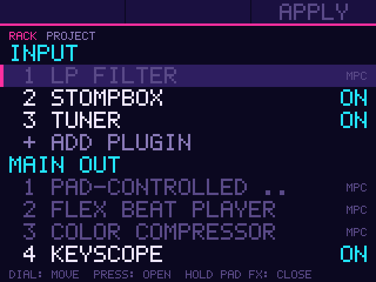
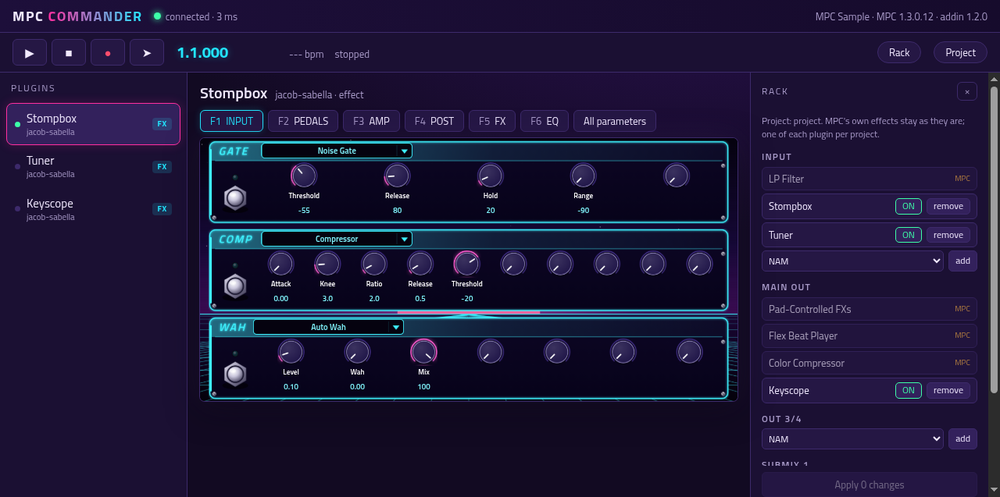
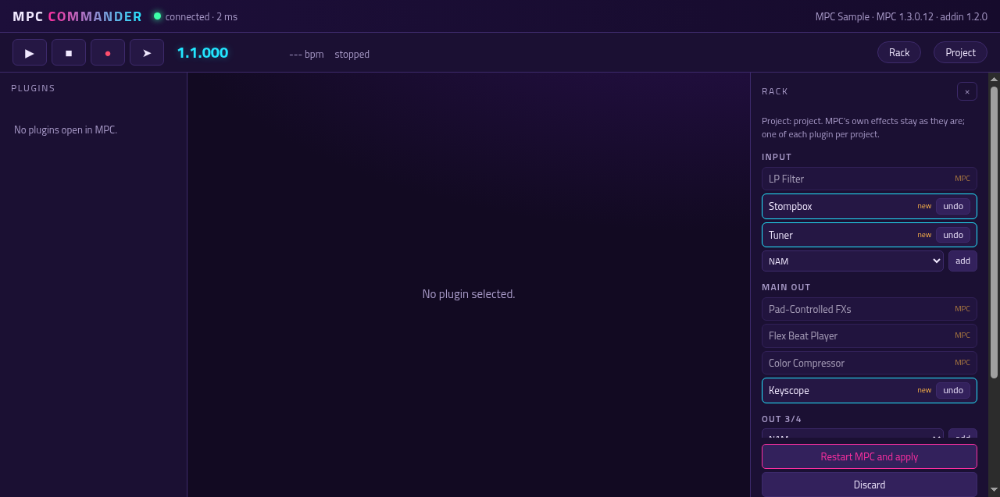
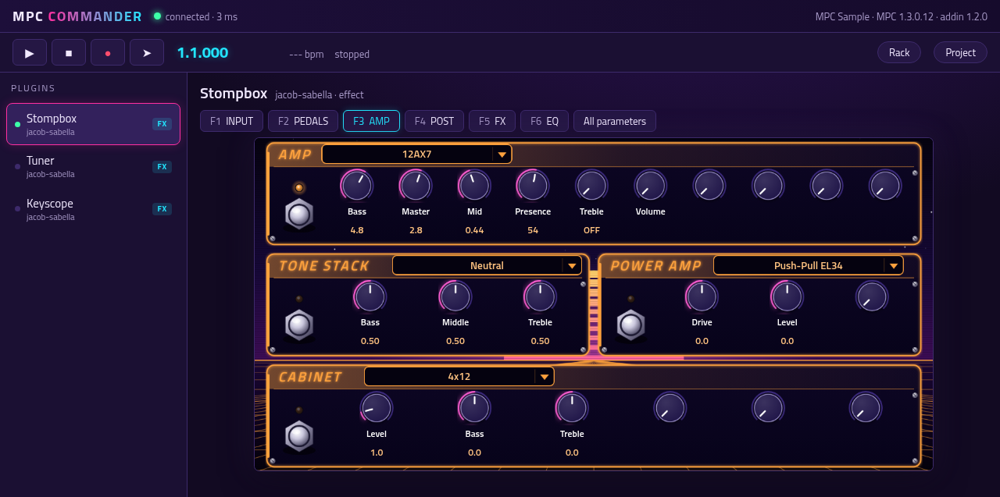
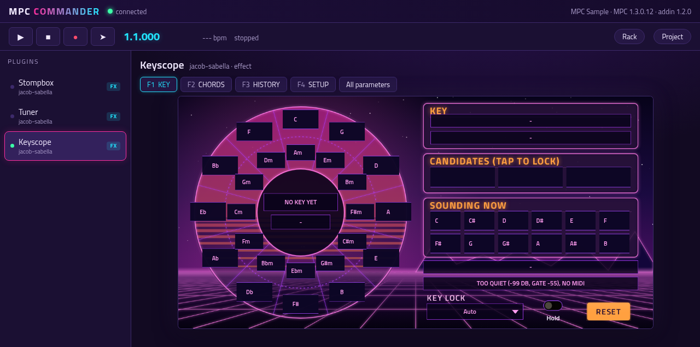

# mpc-addin-sample-rack

An addin for the MPC Sample that manages the plugins in a project's inserts. The Sample has no screen for adding or
removing a plugin, and it can't load or unload one in a running project, so this addin edits the project for it.

In mpc-addin-commander's browser UI (the same rack, through `src/bridge.c`), with the plugins' panels beside it:

- **RACK page** (needs mpc-addin-sample-draw-handler 0.3 or later): a long hold of PAD FX opens it. It lists the
  plugins on the input, the outputs, the submixes and the tracks, and lets you add a plugin, turn one on or off, or
  remove one. A dial press on a plugin opens that plugin's own page, if it has one (mpc-vst-plugins' `"sample_page"`).
- **ON/OFF is live** for a plugin MPC is running: its input goes straight to its output (a one-block crossfade, so no
  click), at once and without a restart, until MPC restarts. APPLY writes the live OFFs into the project with the other
  changes, so they stay off. A plugin that is off in the project isn't running, so turning it on still takes APPLY.
  Live off doesn't delay the dry signal by the plugin's latency, and a plugin turned back on starts from where it left
  off (a delay's old echoes, say). How: the addin interposes `dlsym` for plugin entries, like mpc-addin-commander, and
  hands each lookup on to the next addin that does too, so both work together in either order.
- **APPLY restarts MPC.** The edits are saved, then `sample-rack-apply` runs as a systemd unit of its own: it stops
  MPC, edits the project's working copy (`/data/TempProjects/Temp-Project.xpj`) and starts MPC again. Save the project
  first. Everything else in the file stays byte-for-byte the same.
- **Limits:** one of each plugin per project, four inserts per channel. MPC's own effects are shown but never changed.
- **For other addins in the same process** (`src/bridge.c`): `mpc_sample_rack_api()` (the interface version, 2),
  `mpc_sample_rack_state()` (the rack as a JSON document, malloc'd; each insert has `"live"`: `"on"`, `"off"` or null),
  `mpc_sample_rack_apply(json, why, n)` (the same apply as the page, live OFFs included, refused while one is running)
  and, since interface 2, `mpc_sample_rack_live(slot, index, name, on, why, n)` (live on/off). mpc-addin-commander finds
  them with `dlsym` and offers the rack in its browser UI. There is no socket.

## Settings

`mpc_sample_rack.conf`, next to the library: `enabled` (0 leaves it loaded but idle), `project`, `settings` (the plugins
MPC knows) and `service` (the one APPLY restarts, `ac50.service`).

## Install

With the shared addin installer from mpc-vst-plugins (`tools/release/addin`): `tools/release-aarch64.sh <version>`
builds the zip; on the device, `sh install.sh` in the unpacked folder.

## Develop

`build-aarch64.sh` builds `build/aarch64/mpc_sample_rack.so` and `sample-rack-apply` in an arm64 container.
`tests/test.sh` runs the host tests under ASan and UBSan: the core reads a project and the plugin list and saves edits
(`core_test`), the exports for other addins (`bridge_test`), and `sample-rack-apply` on a copy of a project. Then live
on/off: the real addin preloaded into a stand-in "MPC Sample" (`tests/live_host.c`) that loads a stand-in effect
(`tests/fake_fx.c`), alone and ahead of another addin that hooks `dlsym` (`tests/other_hook.c`).

## License

MIT.
